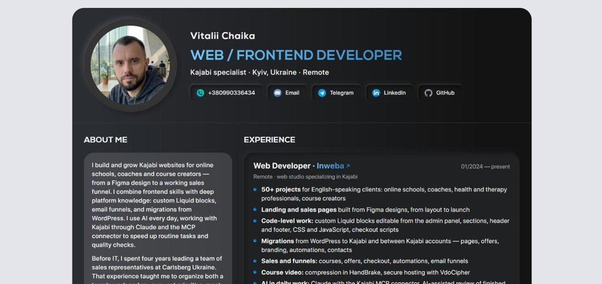

# Vitalii Chaika — Portfolio / CV

Personal one-page CV site: experience, skills, certificates and a project slider.

**Live:** https://chaika911.github.io/myCV/

## Features

- Dark and light themes (choice saved in `localStorage`)
- Infinite project slider with autoplay, arrows and dots
- Skill level indicators generated from `data-level`
- Adaptive layout for desktop, tablet and mobile
- Open Graph tags and favicon set
- CV download (PDF)

## Stack

- HTML5, semantic markup
- CSS3 (custom properties, Grid, Flexbox)
- Vanilla JavaScript

## Contacts

[LinkedIn](https://www.linkedin.com/in/vitalii-chaika-dev/) · [Telegram](https://t.me/vitaliiChaika) · chayka1316@gmail.com
